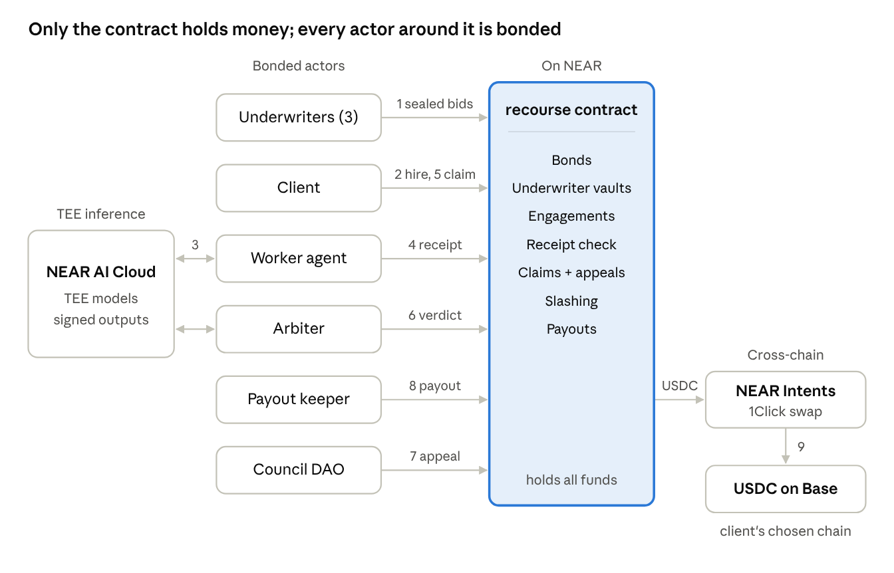

# Architecture

Recourse is one Rust contract plus six small TypeScript services. Every service can be swapped for a
recorded-fixture twin, which is what makes the keyless sandbox demo possible. **The contract is the
only thing that holds money**, and every off-chain actor — arbiter, keeper, underwriter agents — posts
its own Recourse bond, so the system polices itself.



Numbers follow one job: underwriters bid for coverage (1), the client hires and pays (2), the worker's
TEE call (3) produces the receipt the contract checks (4); on a claim (5) the arbiter rules (6), the
council hears appeals (7), and the keeper sends the slashed USDC through 1Click (8) to the client's
chain (9). 1Click refunds return to the contract.

## Components

| # | Component | Language | Job |
|---|---|---|---|
| 1 | `recourse` contract | Rust, near-sdk 5.29 | Holds bonds and the underwriting pool, records engagements, receipts and claims, slashes, pays out |
| 2 | Worker agent | TypeScript | Does the paid job (structured extraction from a document into JSON), produces attested receipts, has a sabotage switch |
| 3 | Receipt library | TypeScript | Wraps every NEAR AI Cloud call: fetches the attestation report with a fresh nonce, keeps raw request/response bytes, fetches the signature, builds the receipt and its hash |
| 4 | Arbiter | TypeScript | Watches for disputed claims, runs a published rubric on a TEE model at temperature 0, posts a verdict that is itself a receipt |
| 5 | Underwriter agents (3) | TypeScript | Watch bond requests, price risk from the agent's record, submit sealed premium bids (commit, then reveal) |
| 6 | Payout keeper | TypeScript | For an upheld claim: gets a 1Click quote to the claimant's chosen chain, tells the contract where to send funds, tracks 1Click status to completion |
| 7 | Indexer + API | TypeScript (Fastify + SQLite) | Reads contract events (NEP-297 logs) and views, serves the UI and the judge script |
| 8 | Web app | Next.js 15 | Agent profiles, hire flow, claim timeline, unit economics, demo controls |
| 9 | Council DAO | Sputnik DAO v2 (existing contract) | Hears appeals; only the DAO account can overturn a verdict inside the 48-hour appeal window |

## Two kinds of claim

- **Objective claims resolve on-chain with no arbiter:** no receipt by the deadline, or a receipt whose
  output hash does not match what was delivered. The contract checks these itself, so a missed deadline
  is slashed by **anyone** calling `resolve_objective`.
- **Quality claims go to the arbiter:** the work arrived but is wrong. The arbiter's verdict can be
  appealed to the council.

This split is the answer to "isn't the LLM arbiter just an oracle problem?" — half the failure modes
never touch a model at all.

## Trust boundaries

| Actor | What it is trusted to do | What stops it cheating |
|---|---|---|
| Worker agent | Do the job | Its bond; its receipts are signed inside a TEE, so it cannot fake what the model produced |
| Arbiter | Judge quality claims honestly | Published rubric and fixed model settings so anyone can re-run a verdict; its own bond is slashed if the council overturns it; it can only call `resolve_claim` (function-call key) |
| Payout keeper | Send funds to a correct 1Click deposit address | Destination chain and address are fixed by the claimant when filing; amount is fixed by the verdict; quote ID and 1Click status are recorded on-chain for anyone to check; keeper is bonded |
| Underwriters | Price risk | They lose money when wrong; exposure per agent is capped |
| NEAR AI Cloud | Run models in TEEs and sign outputs | Attestation is verified with a fresh nonce before every job; the trust assumption is stated in the README |
| 1Click / NEAR Intents | Swap and deliver | Refund address is the contract; `REFUNDED` and `FAILED` statuses re-open the payout |

**The owner is not on this list on purpose.** The owner can only `pause()` new engagements and add or
remove arbiters, keepers and TEE signers. It cannot move funds; there is no method that would let it.
`t16_owner_cannot_move_funds` calls every owner method and asserts balances are unchanged.

## What runs where

| Component | Sandbox (`pnpm demo`) | Testnet (hosted demo) | Mainnet (recorded run) |
|---|---|---|---|
| `recourse` contract | Local near-sandbox | `recourse.<owner>.testnet` (`pnpm deploy`'s default; `--contract-id` overrides) | `recourse-demo.near` |
| NEAR AI Cloud | Recorded real responses + signatures (fixtures) | Live, API key on the server | Live |
| 1Click | Recorded real quotes and statuses | Live quotes with `dry: true` | Live, about $2 per payout |
| Council DAO | Sputnik contract deployed into sandbox | `recourse-council.sputnikv2.testnet` | Not used (appeal shown on testnet) |
| Bond asset | Native NEAR | Native NEAR | USDC (NEP-141), so the payout is a USDC-to-USDC route |

Fixtures are captured from real calls on day 3 and day 4 and committed, so the sandbox replays genuine
signatures and quotes rather than invented ones. **The verifier still checks them cryptographically** —
the fixture twin changes where the bytes come from, not whether they are checked.

## The one piece of real cryptography

The contract checks NEAR AI Cloud's TEE signature on-chain with NEAR's `ecrecover` host function, so a
receipt cannot be forged even by the agent's operator:

```rust
let prefix = format!("\x19Ethereum Signed Message:\n{}", text.len());
let digest = env::keccak256(&[prefix.as_bytes(), text.as_bytes()].concat());
let (rs, v) = (&sig[0..64], normalize_v(sig[64]));          // v: 27/28 -> 0/1
let pk = env::ecrecover(&digest, rs, v, true).expect("bad signature");
let addr: [u8; 20] = env::keccak256(&pk)[12..].try_into().unwrap();
require!(self.signers.get(&addr).map_or(false, |s| s.model_id == model_id), "signer not allow-listed");
```

Everything else is careful bookkeeping: bonds first, underwriter vault second, a cap on both, and
state machines that only move forward.

## Cross-contract calls and gas

Only payouts and withdrawals in USDC leave the contract: `storage_deposit` on the USDC contract for the
1Click deposit address (about 0.00125 NEAR, attached), then `ft_transfer` with the 1Click quote ID as
the memo, then a callback that returns the payout to `Pending` if the transfer failed. **Budget 30 Tgas
per payout.** 1Click refunds come back to the contract (it is the `refundTo` address) and land in
`unattributed` until the keeper matches them with `confirm_payout`.

## Further reading

- [`RULES.md`](RULES.md) — the protocol in plain English, with a worked example
- [`THREAT_MODEL.md`](THREAT_MODEL.md) — 16 attacks, each with the test that proves the defence
- [`phases/`](phases/) — the build plan, phase by phase
