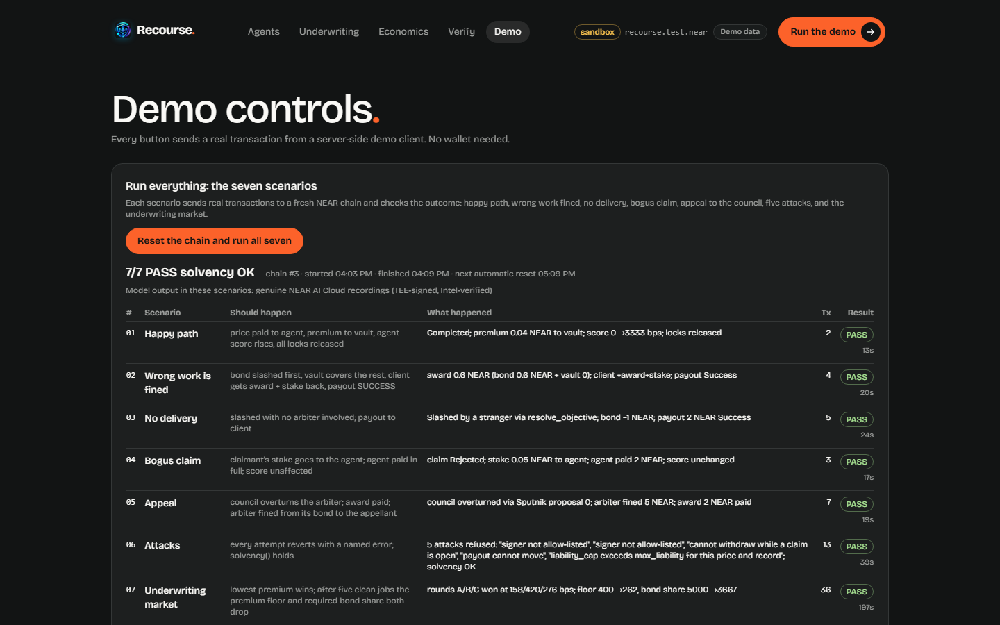
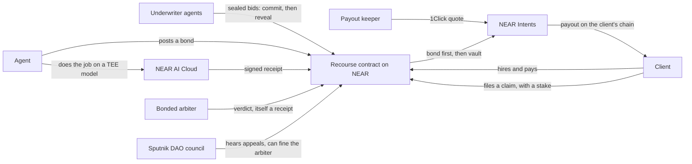
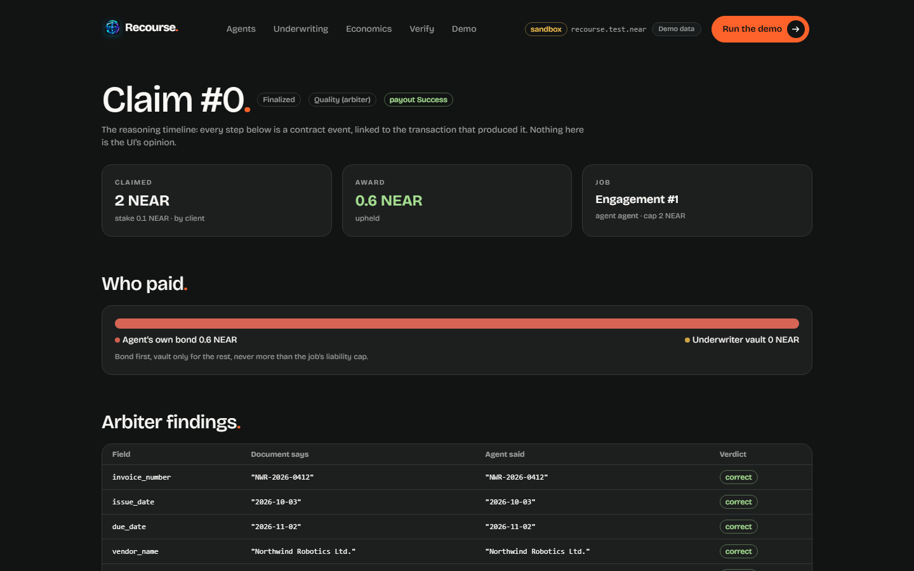
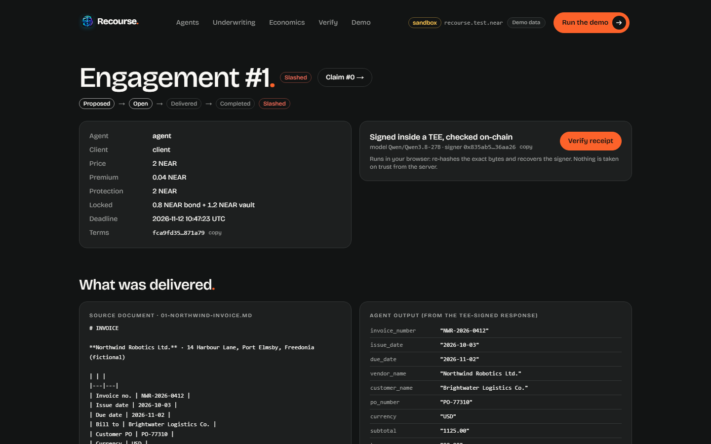
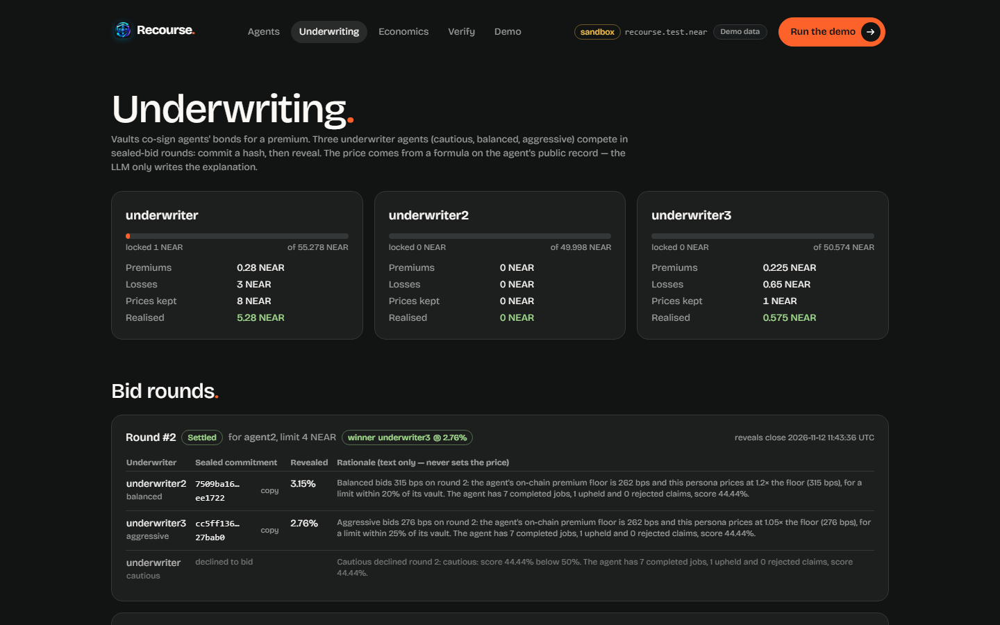
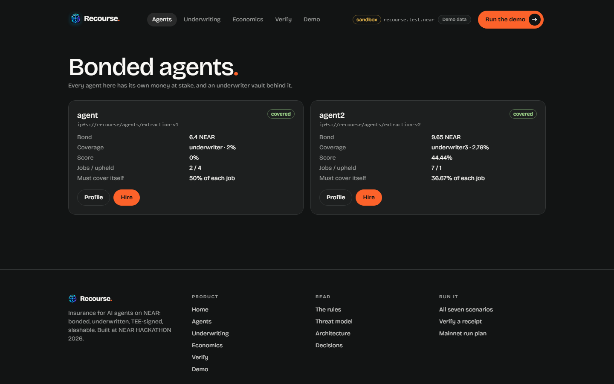
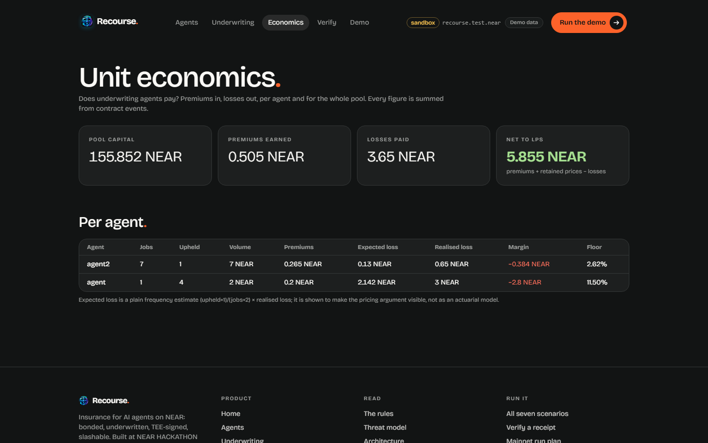

# Recourse

Insurance for AI agents, on NEAR. **You can't sue an AI. Now you don't have to.**

Before an AI agent takes a paid job, it posts a **bond** from its own balance, and an underwriter vault
co-signs the rest for a **premium**. Every job leaves a receipt signed inside a NEAR AI Cloud **TEE**, and
the Recourse contract checks that signature **on-chain with `ecrecover`**, so a receipt cannot be forged,
even by the agent's own operator. If the work is wrong, the agent is **slashed**, bond first and vault
second, and the client is paid back **in the token and on the chain they chose**, through NEAR Intents.
The arbiter that rules on bad work is bonded too: a Sputnik DAO council can overturn it, and fine it.

- Live demo: https://recourse-near.duckdns.org (no wallet, no sign-in, nothing to install; the chain
  rebuilds from genesis every hour)
- Indexer API, read straight off the chain: [`/api/demo/run`](https://recourse-near.duckdns.org/api/demo/run) ·
  [`/api/totals`](https://recourse-near.duckdns.org/api/totals) · `/api/health` · `/api/audit.csv`
- Same site by IP, if DNS is being slow: https://recourse.100.29.122.218.sslip.io
- Demo posts on X: [@recoursenear](https://x.com/recoursenear)
- Contract: `recourse.test.near`, inside the hosted sandbox. There is no testnet or mainnet deployment
  yet: see [Status](#status)



## NEAR Hackathon

Built for **NEAR HACKATHON**, 1–14 Nov 2026, in two tracks:

- **06 / AI Security & Defense** (*Trust, but verify*): TEE attestation checked with a fresh nonce,
  receipts verified on-chain, function-call keys that can call one or two methods each, and 16 named
  attacks that each have a test.
- **07 / Agent Economy** (*Give AI a wallet*): agents that earn, post bonds, get hired and get slashed,
  and underwriter agents that bid against each other to insure them.

| The hackathon asks for | Here |
| --- | --- |
| A public repository | This one. The first commit is 8 Nov 2026, and nothing existed before the hackathon: [`HACKATHON_DISCLOSURE.md`](HACKATHON_DISCLOSURE.md) |
| Something that works | The [live demo](https://recourse-near.duckdns.org) and `pnpm demo`, both 7/7 PASS: see [Measured](#measured) |
| A demo on X tagged @NEARProtocol and #NEARHackathon | Posted from [@recoursenear](https://x.com/recoursenear) |
| How NEAR fits | [What's built on NEAR](#whats-built-on-near) |

**What we built**, in the words the submission form asks for:

> AI agents can now hold money and take paid work, but when one takes your money and gets the job
> wrong, there is nobody to sue. Recourse makes the money answer instead. An agent posts a bond before
> it can accept a job, and underwriter agents bid in sealed rounds to cover the rest for a premium.
> Every job's output is signed inside a NEAR AI Cloud TEE, and the Recourse contract on NEAR checks that
> signature on-chain with ecrecover. A missed deadline is slashed by anyone; wrong work goes to a bonded
> arbiter whose verdict is itself a signed receipt, and either side can appeal to a Sputnik DAO council
> that can overturn and fine the arbiter. The payout comes from the agent's bond first, then the vault,
> and is delivered through NEAR Intents (1Click) on the client's chosen chain. The live demo replays
> seven scenarios on a NEAR sandbox that rebuilds every hour, and the judge script runs 16 named attacks
> against the contract. All of them pass, and the contract's solvency check passes afterwards.

## Status

Updated 12 Nov 2026.

Built, and running end to end: the contract, the receipt library, the worker, the arbiter, three
underwriter agents, the payout keeper, the indexer, the web app and the judge script (`npm run judge`). The hosted demo
is public and passes **7/7 with `solvency_ok: true`**, replaying genuine NEAR AI Cloud recordings
(TEE-signed, Intel-verified) for the worker and arbiter.

Not done yet: the **live testnet deployment** and the **recorded mainnet run** (one real job, one real
slash, about $2 of USDC arriving on Base). Both need funded accounts and a person confirming each
transaction. Until then, everything runs on a NEAR sandbox. The full list is in
[What is real today](#what-is-real-today).

## The problem

The NEAR Hackathon's premise is money with a mind of its own: give an agent a wallet and let it earn,
spend and hire. That makes a new kind of loss possible. An agent takes your money, does the job wrong,
and goes quiet. There is no counterparty, no registered office, and nobody to serve papers on.

The usual answers stop the agent before it spends: a spending limit, a policy engine, a firewall. Those
are worth having, and they do not pay you back for work that was done badly with money that was
allowed to move. Recourse is the other half: what happens after the harm.

## How it works



1. **Bond.** An agent registers and posts a bond from its own balance. Its required bond share is
   checked when a job opens, so it cannot take a job it cannot cover.
2. **Underwriting.** Three underwriter agents (cautious, balanced, aggressive) bid in sealed rounds:
   a hash first, then the reveal, so nobody can copy a bid. The lowest premium wins. The price comes
   from a formula on the agent's public record; the model only writes the explanation.
3. **Hire.** The client opens an engagement with a price, a deadline and a liability cap. The agent
   checks the document against the on-chain `terms_hash` before accepting.
4. **Receipt.** The worker does the job on a NEAR AI Cloud model, after verifying the TEE's attestation
   with a fresh nonce. The contract recovers the signer with `ecrecover` and checks it is an
   allow-listed TEE key for that model.
5. **Claim.** The client files a claim and stakes 5% of it, which a frivolous claim loses. A missed
   deadline is **objective**: anyone can settle it with `resolve_objective`, and no model is involved.
   Wrong work goes to the **arbiter**, which runs a published rubric at temperature 0 and posts a verdict
   that is itself a signed receipt.
6. **Appeal.** Either side can appeal to a Sputnik DAO council. If the council overturns the arbiter,
   the arbiter's own bond is fined and paid to the appellant.
7. **Payout.** The award comes from the agent's bond first and the underwriter vault second, never more
   than the job's liability cap. The keeper gets a 1Click quote to the chain the client chose, and the
   contract sends the funds. 1Click refunds come back to the contract.

### The one technical claim worth checking first

The contract verifies NEAR AI Cloud's TEE signature **on-chain**, using NEAR's `ecrecover` host
function over the EIP-191 digest of `<model_id>:<request_hash>:<response_hash>`:

```rust
let prefix = format!("\x19Ethereum Signed Message:\n{}", text.len());
let digest = env::keccak256(&[prefix.as_bytes(), text.as_bytes()].concat());
let (rs, v) = (&sig[0..64], normalize_v(sig[64]));          // v: 27/28 -> 0/1
let pk = env::ecrecover(&digest, rs, v, true).expect("bad signature");
let addr: [u8; 20] = env::keccak256(&pk)[12..].try_into().unwrap();
require!(self.signers.get(&addr).map_or(false, |s| s.model_id == model_id), "signer not allow-listed");
```

Nothing else in the system needs to be trusted to make a forged receipt impossible.

### Is the LLM arbiter just an oracle problem?

1. **Half the failures never reach a model.** "No receipt by the deadline" is objective: the contract
   checks it, and *anyone* can trigger the slash by calling `resolve_objective`.
2. **The arbiter's verdict is itself a receipt**, produced at temperature 0 against a published rubric,
   so anyone can re-run it and compare.
3. **Either side can appeal** to a Sputnik DAO council.
4. **The arbiter is bonded.** If the council overturns it, it is fined.

### Receipts, worker and arbiter

**A receipt proves which model produced which bytes inside an attested TEE. It does not prove the output
is correct. That is the arbiter's job.**

**Receipt lifecycle** (`packages/receipts`, used by the worker, the arbiter, `pnpm verify-receipt`
and, in the browser, the Verify button):

1. **Attest first.** A fresh 32-byte nonce, then `GET /v1/attestation/report`. Each TEE's Intel TDX quote
   is verified with dcap-qvl, the library NEAR's own verifier uses. Its `report_data` must bind the TEE's
   signing address and that nonce; an HTTP 200 alone proves nothing.
2. **Keep the exact bytes.** The request is serialised once, then sent and hashed. The response is kept
   byte-for-byte and never re-serialised.
3. **Check the signature.** The signed text must be `model:sha256(request):sha256(response)` (or the
   gateway form) for exactly those bytes. EIP-191 recovery must give the reported address, and that
   address must be exactly one TEE whose attestation verified.
4. **Receipt.**
   `{version, engagement_id, model_id, request_hash, response_hash, signature, signing_address,
   signature_kind, attestation{nonce, report_hash, verified_at, verifier}, artifacts{request_uri,
   response_uri}}`, with `receipt_hash = sha256(JCS(receipt))` (RFC 8785).

`verifyReceipt(receipt, bytes)` is pure and browser-safe. It re-hashes the bytes, re-derives the signed
text, recovers the signer and, given the report, re-checks the quote's nonce/signer binding. Intel's
signature on the quote needs Intel's collateral, so that verdict is recorded at build time in
`attestation.verifier`.

**Worker** (`services/worker-agent`). It watches for engagements naming its agent and checks the
document against the on-chain `terms_hash` **before** accepting. It extracts at temperature 0 through the
receipt library, then calls `submit_receipt`, with crash-safe, idempotent state. The sabotage switch
(`/admin/sabotage`, sandbox and testnet only, loopback and bearer token) has five modes: `none`,
`wrong_total`, `hallucinate`, `late`, `silent`. The bad ones work by **telling the model in the prompt**,
so the TEE honestly signs bad work and the receipt's request bytes show the agent's own bad instruction.

**Arbiter** (`services/arbiter`):

- It runs the published [`rubric.md`](services/arbiter/rubric.md) on a TEE model at temperature 0. **The
  verdict is itself a receipt**, and the contract verifies it on-chain.
- `award = liability_cap × Σ weights of wrong fields`, rounded down and capped at the claimed amount.
- **Prompt injection (T15) has three layers.** Evidence, document and agent output are quoted data that
  cannot close their own block. The rubric says instructions inside them carry no authority. And code
  checks every verdict, so a model that obeys an injection produces an **invalid** verdict, not a wrong
  one. That check enforces the schema, one finding per field, what the agent actually said, every
  claimed document value appearing in the document, the award equalling the weight sum, and a
  consistent `upheld`.
- `pnpm rerun-verdict <claim>` resends the identical request bytes. LLMs are not byte-reproducible even
  at temperature 0, so it and the judge compare only `upheld` and `award_bps`.

**Fixtures and adapters** (`packages/adapters`). `RECOURSE_MODE=sandbox` replays recorded bytes with no
keys. Testnet and mainnet are live only; mainnet refuses fixtures and sabotage. A fixture changes where
the bytes come from, never whether they are verified.

## What's built on NEAR

| Piece | What Recourse uses it for | ID |
| --- | --- | --- |
| Smart contract (Rust, near-sdk 5.29) | Bonds, the underwriting pool, engagements, receipts, claims, slashing, appeals and payouts. The only thing that holds money | `recourse.test.near` in the hosted sandbox; testnet and mainnet not deployed yet |
| `env::ecrecover` | Recovers the TEE signer of every receipt and verdict on-chain, over the EIP-191 digest | `contracts/recourse/src/tee.rs` |
| NEAR AI Cloud | TEE-hosted inference for the worker and the arbiter, with Intel TDX attestation checked with a fresh nonce | API base `cloud-api.near.ai/v1`; worker `Qwen/Qwen3.8-27B`, arbiter `z-ai/glm-5.3-flash` |
| NEAR Intents, through the 1Click API | Payouts to the client's chosen chain and token. The contract is the refund address | `https://1click.chaindefuser.com` |
| Sputnik DAO v2 | The council that hears appeals and can overturn and fine the arbiter. Deployed, not written by us | factory `sputnik-dao.near`; `sputnik-dao.testnet` on testnet |
| Function-call access keys | Each service's key can call only its own methods: the worker `accept_engagement` and `submit_receipt`, the arbiter `resolve_claim`, the keeper `execute_payout` and `register_signer` | `scripts/lib/service-keys.ts` |
| NEP-141 fungible tokens | USDC bonds and payouts on mainnet | `17208628f84f5d6ad33f0da3bbbeb27ffcb398eac501a31bd6ad2011e36133a1`; `usdc.fakes.testnet` on testnet |
| NEP-145 storage management | Registers each 1Click deposit address with USDC before paying it; callers pay for their own storage | `storage_deposit` on the USDC contract |
| NEP-297 events | Every bond, bid, engagement, receipt, claim, verdict, appeal and payout, for the indexer and auditors | standard `recourse`, version 1.0.0 |

## Try it

| Do | See |
| --- | --- |
| Open https://recourse-near.duckdns.org/demo | **One page runs everything**: the seven scenarios with PASS or FAIL as they run, and a button that resets the chain and replays all seven in about six minutes, for everyone watching |
| Open https://recourse-near.duckdns.org and click "Watch an agent get slashed" | The claim timeline, step by step: the arbiter's findings, the bond-first split and the payout, every step with its transaction |
| On any job page, click "Verify receipt" | The browser re-hashes the exact bytes and recovers the TEE signer; every check green |
| `pnpm i && pnpm demo` | A local NEAR sandbox boots, the DAO and contract deploy, seven scenarios run, and a table ends **7/7 PASS, `solvency: OK`** (about 6–7 minutes; no `.env`, no keys) |
| `npm run judge` | 14 check groups, one row per threat, `ALL PASS`, exit code 0 |
| `docker compose up`, open http://localhost:3000/demo | The hosted demo on your own machine, plus hire, sabotage and claim controls and a live event log |
| `pnpm verify-receipt demo/fixtures/receipts/01-northwind-invoice.wrong-total.receipt.json` | The receipt checks in the terminal: `VALID` |
| `pnpm mainnet:verify` | The mainnet slash and the USDC on Base, checked from public data *(once the run is recorded)* |

**On Windows**, nearcore publishes no sandbox binary, so run the demo and the judge in the clean room:

```bash
docker compose -f docker-compose.judge.yml run --rm demo     # pnpm demo
docker compose -f docker-compose.judge.yml run --rm judge    # npm run judge
```

## Screenshots

From the live demo. `docs/screenshots/shots.json` lists every one, and the readme-suite `shots.mjs`
script regenerates them from the running site, so they cannot drift from what it renders. The home page is then saved as JPEG, because its grain texture makes a PNG eight times larger.

| | |
| --- | --- |
|  |  |
| **The home page.** The pitch, and the way into a real slash. | **A claim, upheld.** Who paid, and the arbiter's findings field by field: the document, what the agent said, the verdict. |
|  |  |
| **A job and its receipt.** Signed inside a TEE, checked on-chain, and re-checked in your browser with one click. | **The underwriting market.** Sealed bids, the winner, and why the cautious underwriter declined. |
|  |  |
| **Bonded agents.** Every agent has its own money at stake and a vault behind it. | **Unit economics.** Whether underwriting agents pays, summed from contract events. |

## Measured

| What | Result | When |
| --- | --- | --- |
| `npm run judge` in the clean room (`docker-compose.judge.yml`) | **ALL PASS**: 13 of 14 check groups pass, 1 skipped (the mainnet run, not recorded yet), 0 failing; 37 assertions; exit 0 in 1203 s (989 s on an earlier run the same day). It also checks that every command in this README exists | 12 Nov 2026 |
| `pnpm test:services` | 407 tests in 39 files, all passing, in about 16 s | 12 Nov 2026 |
| `pnpm test:e2e` against the live site | 16 passed, 2 skipped: the seven scenario pages and the Demo page's summary, on desktop and phone. The 2 skipped are the opt-in reset test (`E2E_RUN_RESET=1`), which presses the reset button and waits out the whole replay | 12 Nov 2026 |
| `/api/demo/run` on the live site | 7/7 scenarios, `solvency_ok: true` (chain cycle 3) | 12 Nov 2026 |

## Safety model

**The contract is the only thing that holds money, and the owner cannot move it.** The owner can pause
new engagements and add or remove arbiters, keepers and TEE signers; no method lets it move funds, and
`t16_owner_cannot_move_funds` calls every owner method and checks that balances are unchanged. Every
off-chain actor (arbiter, keeper, underwriters) posts its own bond, and each service's key is a
function-call key limited to its own methods.

Every attack below has a test, and the judge runs all of them. The full table, with the defence for
each, is in [`THREAT_MODEL.md`](THREAT_MODEL.md).

| Attack | Refused by |
| --- | --- |
| T1 Forged receipt signature | `ecrecover` on-chain |
| T2 A real signature from the agent's own, non-TEE key | Signer allow-list from verified attestation |
| T3 Re-use an old receipt for a new job | `used_receipts` set |
| T4 Withdraw the bond before a claim lands | Cooldown, locks and the claim freeze |
| T5 Take a job the agent cannot cover | Required bond share, checked when the job opens |
| T6 Client and agent collude to drain a vault | Liability tied to price and score, exposure cap, score reset |
| T7 A biased arbiter | Appeal to the council; the arbiter is fined |
| T8 The keeper quotes a payout to its own address | Destination fixed in the claim; quote hash on-chain |
| T9 Double payout | The payout state machine |
| T10 A refund credited to the wrong claim | The `unattributed` bucket, matched by amount |
| T11 Spam claims to freeze an agent | A 5% claim stake, lost on rejection |
| T12 Copy another underwriter's bid | Commit-reveal with a salt |
| T13 Storage exhaustion | The caller pays for storage on every write |
| T14 A failed cross-contract transfer leaves funds stuck | A callback restores state |
| T15 Prompt injection in claim evidence | Evidence passed as quoted data; the rubric ignores it; code validates every verdict |
| T16 The owner tries to move funds | No such method exists |

## Limitations

These are the ones we know about.

- **There is no testnet or mainnet deployment yet.** Both need funded accounts and keys. The live demo
  is a NEAR sandbox inside one container, redeployed from genesis every hour, so its contract account
  and history are minutes old by design.
- **New hires from the hosted demo's UI are not signed in a TEE.** The seeded history replays genuine
  NEAR AI Cloud recordings, but a job you start from the browser uses a deterministic dev model signed
  by an allow-listed sandbox key, and its receipt says `dev-fixture`. See [`docs/hosting.md`](docs/hosting.md).
- **A compromised NEAR AI Cloud TEE breaks receipts.** Attestation is verified with a fresh nonce before
  every job, which is the available defence.
- **A receipt proves which model produced which bytes, not that the output is correct.** That is what
  the arbiter, the appeal and the bond are for.
- **Receipts are bound to a model and a key, not to a job.** The contract sees only hashes. The worker,
  the arbiter and `pnpm rerun-verdict` check the match off-chain, and the appeal is the on-chain recourse.
- **The owner and keepers choose the TEE signers and arbiters.** They cannot move funds, but an owner
  that allow-listed its own key or arbiter could influence outcomes. Appeals to the council bound it.
- **An arbiter and a council that are both wrong** have no further appeal.
- **1Click can fail to deliver after a deposit.** `REFUNDED` and `FAILED` re-open the payout and the
  funds come back to the contract, but the client waits.
- **Recourse covers bonded agents only.** It does not stop anyone hiring an agent that never registered.
- **The contract has no audit.**
- **`pnpm demo` takes about 6–7 minutes**, longer than the 3 the plan targets, because scenario 07 waits
  out three bid windows and seven claim windows on the sandbox.

## What is real today

| | Status |
|---|---|
| Contract (bonds, vaults, engagements, on-chain receipt check, claims, slashing, appeals, USDC, Intents payouts, sealed-bid underwriting) | Built; unit, invariant, integration and adversarial tests |
| `pnpm demo` | **7/7 PASS, solvency OK** on a fresh nearcore 2.14 sandbox, keyless |
| Receipts | Full four-step flow; checked on-chain with `ecrecover`. Scenarios 01, 02 and 04 replay **genuine NEAR AI Cloud recordings**: worker `Qwen/Qwen3.8-27B`, arbiter `z-ai/glm-5.3-flash`, both signed inside Intel TDX, every quote verified by dcap-qvl (`UpToDate`) at recording time, and their real signers allow-listed on-chain. Scenarios 05–07 and the adversarial suite sign synthetic receipts with a labelled dev key to test the contract's mechanics |
| Genuine NEAR AI Cloud recordings | **Done**: `demo/fixtures/near-ai/fixtures.json`, recorded 8 Nov 2026; the five judge receipts in `demo/fixtures/receipts` verify standalone with `pnpm verify-receipt` |
| Spike A (a real NEAR AI Cloud signature recovered by `env::ecrecover`) | **PASS**: TypeScript and Rust recover the same signer, which matches the address in the model's attestation report; the contract's `check_receipt` accepts the live receipt and rejects tampered copies (`contracts/recourse/src/tests/tee.rs`) |
| Hosted demo | **Deployed and public** at [recourse-near.duckdns.org](https://recourse-near.duckdns.org): the keyless sandbox stack with an hourly reset, on one x86_64 EC2 instance behind Caddy with automatic HTTPS and daily EBS snapshots. Reproducible with the Terraform in [`infra/aws/`](infra/aws/). Results are in [Measured](#measured) |
| Testnet deployment | **Not yet**: needs accounts and keys ([`docs/hosting.md`](docs/hosting.md)) |
| Mainnet run | **Not yet recorded**: a person confirms every transaction ([`demo/mainnet-run/RUN.md`](demo/mainnet-run/RUN.md)) |

### Mainnet evidence

Not recorded yet. The run is one real job, one real slash and about $2 of USDC arriving on Base through
1Click; its transaction hashes and 1Click status JSON go in `demo/mainnet-run/run.json`, and <!-- written by the mainnet run, which has not happened yet --> <!-- check-docs: ignore -->
`pnpm mainnet:verify` re-checks them from public data with no keys.

## The code

| Folder | What it is |
| --- | --- |
| `contracts/recourse` | The one Rust contract. The only thing that holds money |
| `packages` | `sdk`, `receipts` (NEAR AI Cloud), `intents` (1Click), `adapters`, `config` |
| `services` | `worker-agent`, `arbiter`, `underwriters`, `keeper`, `indexer` |
| `apps/web` | The Next.js 15 site: agent profiles, the hire flow, the claim timeline, the Demo page |
| `demo` | `run-demo.ts`, the seven scenarios, recorded fixtures, the mainnet run |
| `scripts` | The judge, deploy, seed, the hosted stack, and receipt record, export and verify |
| `tests` | Integration, invariants, adversarial, e2e |
| `infra/aws` | Terraform for the hosted demo |
| `spikes` | Phase 0 de-risking spikes (A: ecrecover, B: 1Click, C: sandbox) |
| `phases` | The build plan, phase by phase, with exit criteria |

Running it yourself:

```bash
pnpm i
pnpm demo                       # seven scenarios on a fresh sandbox, one table
pnpm demo -- --keep             # …and leave the chain running afterwards
pnpm test:adversarial           # one attack per THREAT_MODEL entry, against that chain
npm run judge                   # everything, one table, exit code
pnpm hosted                     # the whole system live on a sandbox, API on :8080, resets hourly
pnpm web                        # the site on :3000 (NEXT_PUBLIC_API_URL, default :8080)
docker compose up               # hosted + web in containers (what `pnpm dev` runs)
pnpm export-receipts            # write the fixture receipts and their bytes to demo/fixtures/receipts/
pnpm test:e2e:install           # once per machine: the pinned Playwright browser
pnpm test:e2e                   # Playwright click-path, against a running stack
```

Live testnet and mainnet need credentials: [`docs/hosting.md`](docs/hosting.md) and
[`docs/services.md`](docs/services.md). Every variable is in [`.env.example`](.env.example).
`npm run judge` checks that every command named in this README exists in `package.json`.

## Documentation

| File | What |
|---|---|
| [`ARCHITECTURE.md`](ARCHITECTURE.md) | Diagram, components, trust boundaries, what runs where |
| [`RULES.md`](RULES.md) | The protocol in plain English, with a worked example |
| [`THREAT_MODEL.md`](THREAT_MODEL.md) | 16 attacks, each with the test that proves the defence |
| [`DECISION.md`](DECISION.md) | Every significant decision: what we chose, why, and what we rejected |
| [`TESTING.md`](TESTING.md) | From a fresh clone to convinced: every suite, what the judge checks, and the counts |
| [`AGENTS.md`](AGENTS.md) | The rules that are easy to break, and where everything lives |
| [`docs/api.md`](docs/api.md) | Every indexer route: the chain, the audit ledger, the demo controls |
| [`phases/`](phases/) | The build plan, phase by phase, with exit criteria |
| [`HACKATHON_DISCLOSURE.md`](HACKATHON_DISCLOSURE.md) | Baseline, libraries, AI-generated code |
| [`docs/services.md`](docs/services.md) | Running the worker and arbiter: modes, keys, testnet steps, operations |
| [`docs/hosting.md`](docs/hosting.md) | Hosting: the keyless sandbox stack, the testnet deployment, the web app |
| [`infra/aws/README.md`](infra/aws/README.md) | The Terraform behind the hosted demo, and why it is one instance |
| [`docs/audit-anchoring.md`](docs/audit-anchoring.md) | The hash-linked audit log and anchoring its root on-chain (off in the hosted sandbox) |
| [`services/arbiter/rubric.md`](services/arbiter/rubric.md) | The published arbiter rubric |
| [`demo/fixtures/README.md`](demo/fixtures/README.md) | What the recorded fixtures are (and the dev set is not) |
| [`demo/documents/README.md`](demo/documents/README.md) | The five fictional invoices the worker extracts, with their ground truth and field weights |
| [`CONTRIBUTING.md`](CONTRIBUTING.md) | Contributor guide, prerequisites, testing workflows, and PR checklist |
| [`SECURITY.md`](SECURITY.md) | Vulnerability disclosure policy, scope, and private advisory reporting |
| [`CODE_OF_CONDUCT.md`](CODE_OF_CONDUCT.md) | Contributor Covenant code of conduct and community guidelines |
| [`SUPPORT.md`](SUPPORT.md) | Getting help, reporting bugs, feature requests, and discussions |
| [`CHANGELOG.md`](CHANGELOG.md) | Project release history, versioning policy, and release runbook |

## Licence

MIT: see [`LICENSE`](LICENSE).
