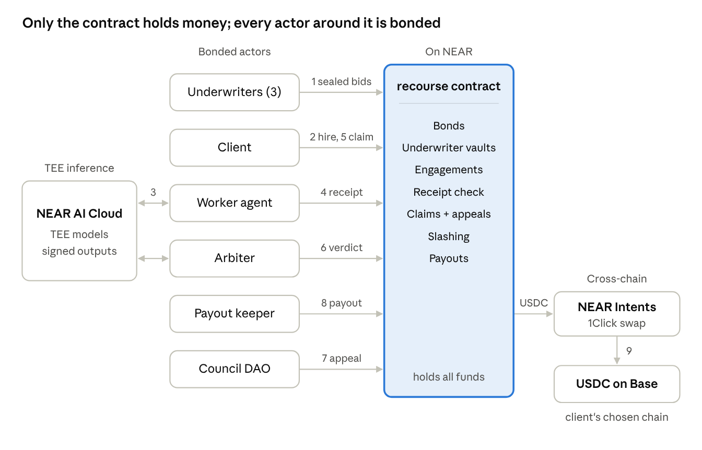
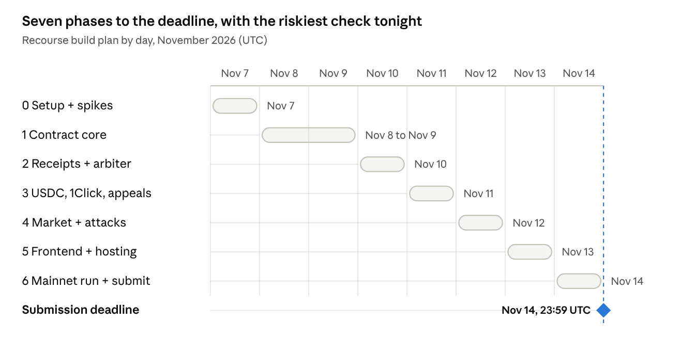

# Recourse — Phase Plan Index

Derived from `Recourse — Implementation Plan (NEAR HACKATHON 2026).docx` (Nov 7, 2026 · @Arpit).
Each phase file is self-contained: it carries the spec detail that phase needs, so the
implementer (human or coding agent) never has to go hunting in the master plan mid-build.

**Deadline:** 14 Nov 2026, 23:59 UTC (5:29 am IST, 15 Nov). **Submission target:** 20:00 UTC, 14 Nov.
**Code freeze:** 14:00 UTC, 14 Nov.

## Architecture at a glance

Numbers follow one job: underwriters bid for coverage (1), the client hires and pays (2), the worker's
TEE call (3) produces the receipt the contract checks (4); on a claim (5) the arbiter rules (6), the
council hears appeals (7), and the keeper sends the slashed USDC through 1Click (8) to the client's
chain (9). 1Click refunds return to the contract.

**Only the contract holds money; every actor around it is bonded.** This diagram belongs in
`ARCHITECTURE.md` — see [Phase 5](phase-05-frontend-hosting-docs.md).

## Phases

| Phase | File | Dates (UTC) | Theme | Hard gate |
|---|---|---|---|---|
| 0 | [phase-00-setup-and-spikes.md](phase-00-setup-and-spikes.md) | Sat 7 Nov, evening | Repo, toolchains, accounts, 3 spikes | Spike A recovers the TEE signer in **both** Rust and TS |
|   | [phase-00-status-snapshot.md](phase-00-status-snapshot.md) | — | Phase 0 checklist as it stood in early November, kept for the record | — |
| 1 | [phase-01-contract-core.md](phase-01-contract-core.md) | Sun 8 – Mon 9 Nov | The Rust contract: bonds, vaults, engagements, claims, slashing, pricing | Unit + invariant tests green; scenarios 01 & 03 on sandbox |
| 2 | [phase-02-receipts-worker-arbiter.md](phase-02-receipts-worker-arbiter.md) | Tue 10 Nov | TEE receipts, worker agent, arbiter, fixtures | A live receipt accepted on testnet; a tampered one rejected |
| 3 | [phase-03-money-out.md](phase-03-money-out.md) | Wed 11 Nov | USDC (NEP-141), 1Click payouts, Sputnik appeals, first mainnet slash | One real payout reaches Base with `SUCCESS` on-chain |
| 4 | [phase-04-underwriting-indexer-attacks.md](phase-04-underwriting-indexer-attacks.md) | Thu 12 Nov | Sealed-bid underwriting, indexer/API, 16 adversarial tests | `pnpm demo` 7/7 PASS + `solvency: OK` on a fresh clone |
| 5 | [phase-05-frontend-hosting-docs.md](phase-05-frontend-hosting-docs.md) | Fri 13 Nov | Next.js app, hosting, Playwright, judge script, docs | `npm run judge` ALL PASS in a clean Docker container |
| 6 | [phase-06-mainnet-video-submission.md](phase-06-mainnet-video-submission.md) | Sat 14 Nov | Recorded mainnet run, 90-second video, submission | Submission returns 201; repo public; X post live |

Phase 1 is the only two-day phase, because every later phase sits on top of the contract.

## Scope tiers (the cut line)

| Tier | What | Rule |
|---|---|---|
| **Must** | Bond, engagement, receipt, claim, arbiter verdict, slash, 1Click payout (dry-run + 1 mainnet), underwriting pool, sandbox demo, judge script, hosted sandbox UI, README | Nothing ships without all of these |
| **Should** | Underwriter agents bidding premiums, track-record pricing, reasoning timeline, unit-economics panel, DAO appeal, Confidential Intents payout | Cut in this order if a day slips: DAO appeal, then bidding agents |
| **Stretch** | BTC bond on a chain-signature address, ERC-8004 export of an agent's record | Only if every Must and Should is green by end of 12 Nov |

A solo builder should drop the **Should** tier on day 1. The plan assumes two builders at ~12 h/day,
or one builder working with a coding agent.

## Key decisions (do not relitigate mid-build)

- **One Rust contract** (`recourse`) holds bonds, vaults and claims. The pool is a *module* of the
  same contract, not a second contract — this keeps cross-contract calls and their failure modes out
  of the critical path.
- **Testnet for the protocol, mainnet only for the payout leg**, because NEAR Intents has no testnet.
  Mainnet spend: about $5 of USDC total.
- **Every external service sits behind an adapter with a recorded-fixture twin**, so the sandbox demo
  is deterministic and keyless while testnet/mainnet modes call the real services.
- **TypeScript for all off-chain code and the UI**, so one pnpm workspace builds everything.

## Daily rhythm

Start each day by running `npm run judge` on `main`. End it by ticking that phase's exit criteria in
its file. Nothing new starts after the 14:00 UTC freeze on 14 Nov.

Every phase file ends with an **Exit criteria** block and an **If behind** line. A phase is not done
until every exit criterion is true. If a phase runs late, cut what the "If behind" line says — the
deadline never moves.

## Cross-phase reference

- [Scope, invariants and threat model summary](reference-invariants-and-threats.md) — the eight
  invariants, the 16 threat-model entries, and the risk/fallback table, in one place.
