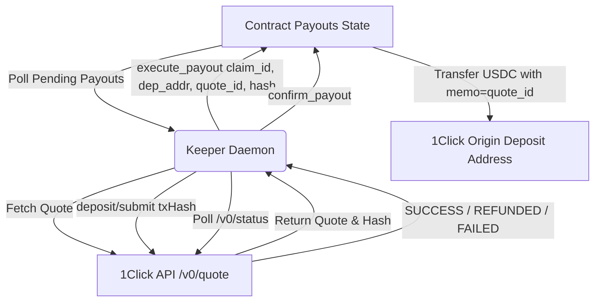

# Recourse Payout Keeper (`@recourse/keeper`)

The Payout Keeper is an autonomous background daemon responsible for discovering pending claim payouts, generating 1Click Intents quotes for cross-chain delivery, submitting deposit transactions, polling 1Click swap status, reconciling outcomes on-chain, and periodically registering TEE model signers.

---

## 1. Responsibilities & Architecture

1. **Pending Payout Discovery:**
   - Polls `get_pending_payouts()` from the Recourse smart contract.
   - For `Intents` mode payouts, validates destination chain and recipient.

2. **1Click Quote Creation & Verification:**
   - Looks up dynamic token asset IDs via `OneClickClient.tokens()`.
   - Generates exact-input quote (`originAsset` USDC on NEAR $\to$ `destinationAsset` USDC on Base).
   - Validates recipient matches claimant's authorized Base recipient (mitigating Threat `T8`).
   - Computes lowercase hex SHA-256 of raw quote response bytes.

3. **On-Chain Execution (`execute_payout`):**
   - Invokes `execute_payout(claim_id, deposit_address, quote_id, quote_hash)` with required storage deposit attached (~0.00125 NEAR).
   - Contract registers the deposit address on NEP-141 USDC contract if necessary, transfers USDC with `memo = quote_id`, and advances payout to `Sent` status.

4. **Deposit Submission & Polling:**
   - Posts `deposit/submit` with deposit address and NEAR transfer transaction hash to 1Click.
   - Polls `GET /v0/status?depositAddress=...` with exponential backoff and jitter.

5. **Reconciliation & Confirmation (`confirm_payout`):**
   - On `SUCCESS`: calls `confirm_payout(claim_id, quote_id, "SUCCESS", dest_tx)` recording the destination transaction on Base.
   - On `REFUNDED`: waits for contract `sync_unattributed()` to witness the refunded balance via two quiet reads $\ge 30$ seconds apart, then calls `confirm_payout(claim_id, quote_id, "REFUNDED")` resetting payout to `Pending` for idempotent retry.
   - On `FAILED`: marks terminal failure.

6. **Periodic Signer Registrar:**
   - Runs on a 30-minute interval loop.
   - Attests each configured NEAR AI model, computes SHA-256 attestation hash, and registers new TEE signers with `register_signer`.

---

## 2. Configuration & Modes

| Variable | Description | Default |
|---|---|---|
| `RECOURSE_MODE` | Operating mode: `sandbox`, `testnet`, or `mainnet` | `sandbox` |
| `RECOURSE_RPC_URL` | NEAR RPC endpoint | Auto-selected by mode |
| `RECOURSE_CONTRACT_ID` | Recourse contract account ID | Required |
| `KEEPER_ACCOUNT_ID` | Keeper account ID | Required |
| `KEEPER_FC_KEY` | ed25519 Function-Call private key | Required |
| `ONECLICK_URL` | 1Click Intents API base URL | `https://1click.chaindefuser.com` |
| `ONECLICK_JWT` | Partner JWT (avoids 0.25% fee) | Optional (for live payouts) |
| `KEEPER_POLL_MS` | Payout poll interval in ms | `3000` |
| `KEEPER_STATE_FILE` | Local persistent state path | `.data/<mode>-keeper-state.json` |
| `KEEPER_DRY_QUOTE` | Whether to request dry quotes | `true` on testnet |
| `NEARAI_API_KEY` | NEAR AI Cloud API key for attestation | Optional in sandbox |

---

## 3. Threat T8 Defense & Verification

The keeper cannot steal or redirect funds:
- The payout destination address and chain are immutably specified by the claimant when filing the claim.
- The keeper passes the quote hash to `execute_payout`, which is recorded on-chain.
- The public independent verification tool (`pnpm mainnet:verify`) checks 1Click's public status API to verify that the destination recipient matches the claimant's authorized Base recipient.
